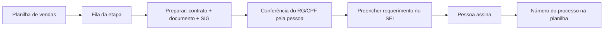

# Robô de Protocolo SEI

Robô que abre, em lote, processos de troca de titularidade de IPTU no SEI de uma prefeitura: junta os documentos de cada comprador, confere os dados e preenche o requerimento até a tela de assinatura.

    

> Projeto real. Este repositório é uma **cópia de portfólio**: segredos, servidores e nomes de empresas foram removidos ou trocados pelo nome fictício "Natela".

## Sumário

1. [O que o projeto faz](#1-o-que-o-projeto-faz)
2. [Instalação e requisitos](#2-instalação-e-requisitos)
3. [Como rodar e usar](#3-como-rodar-e-usar)
4. [Demo visual](#4-demo-visual)
5. [Suporte e ajuda](#5-suporte-e-ajuda)
6. [Contribuição e manutenção](#6-contribuição-e-manutenção)
7. [Licença e status](#7-licença-e-status)

## 1. O que o projeto faz

**O que resolve:** Uma loteadora precisava abrir centenas de processos idênticos no SEI da prefeitura (um por lote vendido), copiando dados e anexando três PDFs à mão — horas de trabalho repetitivo e erros de quadra, lote e CCI copiados do cliente anterior.

**Como resolve:** O robô lê a planilha de vendas, baixa contrato e documento de cada comprador no sistema do loteamento, confere o titular no SIG da prefeitura, mostra uma tela para a pessoa confirmar as páginas do RG/CPF e preenche o requerimento no SEI. Quem assina continua sendo a pessoa.

**Para quem é:** Loteadoras, imobiliárias e escritórios que protocolam processos repetitivos no SEI.

**Por que importa:** Um protocolo por vez, em ritmo humano, sem erro de digitação e com controle de status em planilha — e sem nunca assinar sozinho.

### Principais benefícios

| Protocola em minutos | Zero erro de copiar e colar | Humano sempre assina |
|---|---|---|

### Funcionalidades

- Painel web local (porta 8780) para escolher a etapa, gerar a fila e acompanhar o andamento
- Preparação só leitura: baixa contrato e documento, separa o RG e confere quadra/lote no contrato
- Classificação do titular no SIG (empresa, ex-comprador, já no nome do cliente, outra pessoa)
- Bloqueio automático de lotes com débito de IPTU vencido
- Tela de conferência com miniaturas de todas as páginas do documento
- Preenchimento do SEI com pausas e digitação humanas; para na tela de assinatura
- Planilha de controle com status por cliente, trava entre processos e gravação só das linhas alteradas
- Versão portátil (.exe com Chromium embutido) e modo apresentação para gravar demonstração

## 2. Instalação e requisitos

### Pré-requisitos

| Ferramenta | Versão |
|---|---|
| Python | 3.12 |
| Playwright | com Chromium |
| Bibliotecas | pymupdf, pandas, openpyxl |
| Windows | 10/11 (painel e .bat) |

### Instalação

```bash
git clone https://github.com/jhonatancamargo121/robo-protocolo-sei.git
cd robo-protocolo-sei
pip install playwright pymupdf pandas openpyxl
python -m playwright install chromium
```

Não usa `.env`: os dados fixos do requerente, as URLs dos sistemas e os tipos de documento ficam em `config.py` (valores fictícios neste repositório).

### Variáveis de ambiente

| Variável | Para que serve |
|---|---|
| `EMPRESA` | Dados do requerente usados no requerimento |
| `URL_SEI / URL_SIG` | Endereços do SEI e do SIG da prefeitura |
| `API_LOTEAMENTO / API_TOTVS` | Sistemas de onde vêm contratos e compradores |
| `CONTROLE` | Planilha de controle dos protocolos |

A lista completa, com comentários, está no `.env.example`. Nenhum valor real é versionado.

## 3. Como rodar e usar

### Quick start

```bash
python abrir_navegador.py
python painel.py
```

Ou dois cliques em `ABRIR PAINEL.bat`. O passo a passo completo por linha de comando está em [LEIA-ME.txt](LEIA-ME.txt).

### Exemplo de uso

Requisição:

```bash
python preparar.py 10
```

Resposta esperada:

```text
Prepara os 10 próximos clientes da etapa: baixa contrato e documento, confere o SIG e marca cada linha como PREPARADO, VERIFICAR ou SEM ANEXO na planilha de controle.
```

## 4. Demo visual

Fluxo principal:



> Prints e GIF com dados fictícios estão no roadmap. Para ver o sistema rodando, siga o [Quick start](#3-como-rodar-e-usar).

## 5. Suporte e ajuda

- **Documentação:**
  - [Passo a passo de uso](LEIA-ME.txt)
  - [Configuração](config.py)
- **Issues:** abra uma [issue](https://github.com/jhonatancamargo121/robo-protocolo-sei/issues) para reportar problemas ou sugerir melhorias.
- **Discussions:** dúvidas gerais em [Discussions](https://github.com/jhonatancamargo121/robo-protocolo-sei/discussions).
- **Contato:** pelo perfil [@jhonatancamargo121](https://github.com/jhonatancamargo121)

## 6. Contribuição e manutenção

### Como contribuir

1. Faça um **fork** do repositório
2. Crie uma **branch** a partir da `main` (`git checkout -b feat/minha-melhoria`)
3. Abra um **Pull Request** descrevendo o que mudou e por quê

### Padrões

- Commits no padrão [Conventional Commits](https://www.conventionalcommits.org/pt-br/) (`feat:`, `fix:`, `docs:`…)
- Lint e formatação passando antes do PR
- Testes rodando antes do PR

### Testes

Este projeto ainda não tem suíte automatizada; ela está no roadmap.

### Mantenedores

| | |
|---|---|
| **Jhonatan Camargo** ([@jhonatancamargo121](https://github.com/jhonatancamargo121)) | Mantenedor |

## 7. Licença e status

### Licença

Código proprietário, publicado para fins de portfólio. Todos os direitos reservados; veja o arquivo [LICENSE](LICENSE).

### Status


### Próximos passos

- [ ] Testes automatizados das regras de classificação
- [ ] Modo multi-máquina com fila compartilhada
